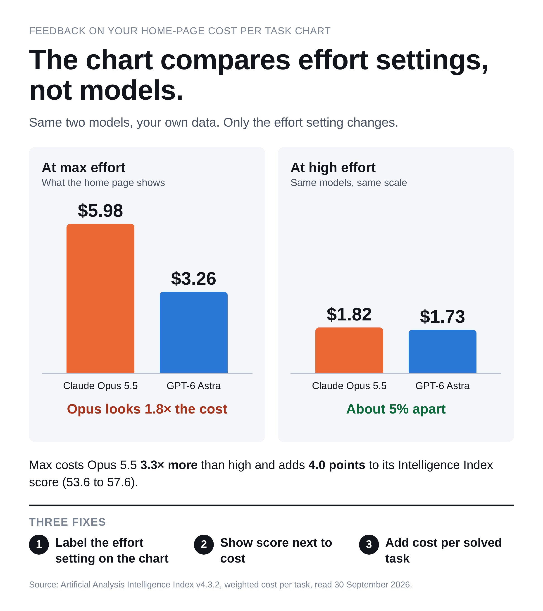
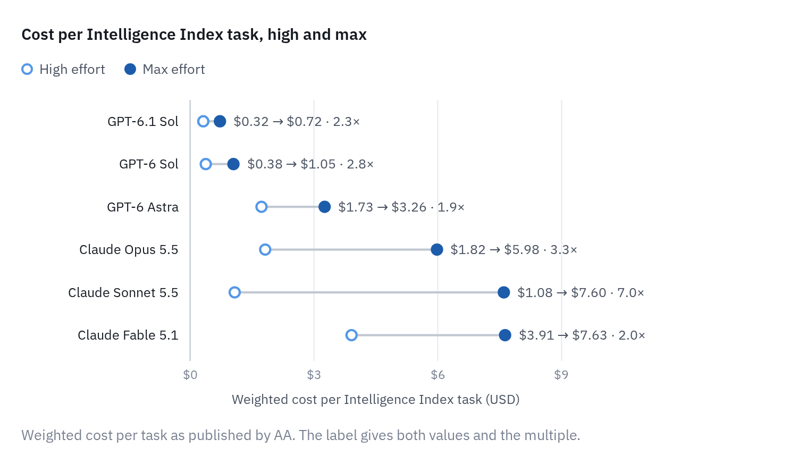
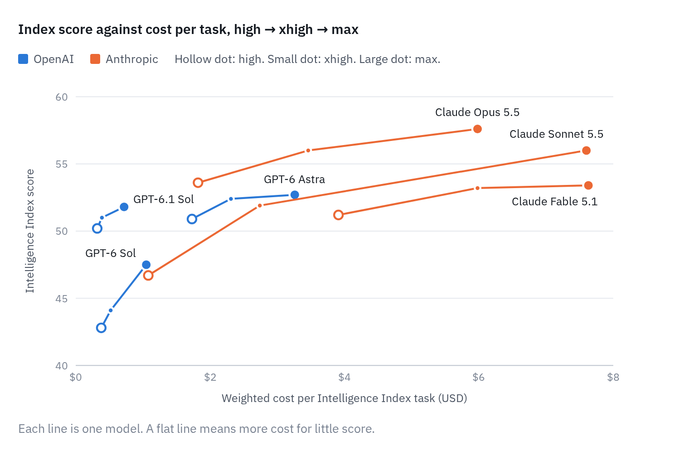
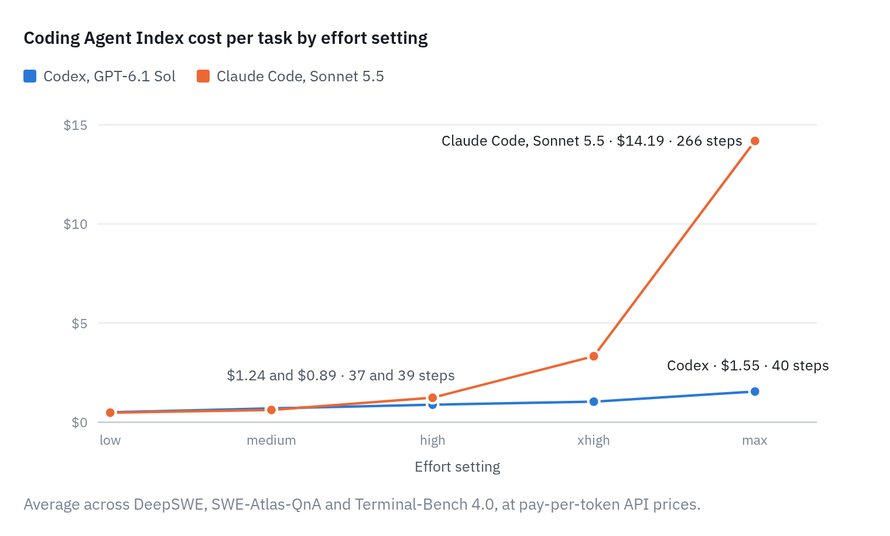
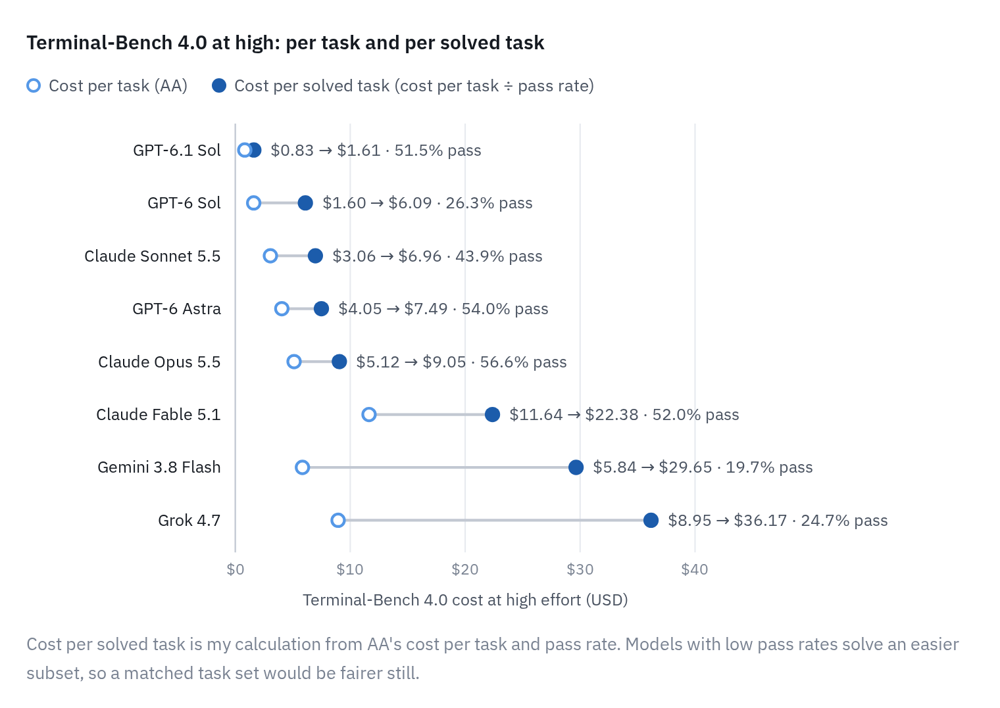

# The Cost per Task chart compares effort settings, not models

Feedback for [Artificial Analysis](https://artificialanalysis.ai/) on the Cost per Task chart in the Highlights block of its front page.



The chart shows each model at one effort setting, usually max, and a few at high or xhigh. It doesn't say which. I read it at face value, decided Claude was too expensive, and didn't use it for two months.

Every figure below comes from the data Artificial Analysis embeds in its own pages, read on 30 September 2026. `extract.py` pulls it again.

## Summary

- Claude Opus 5.5 costs $5.98 per task at max and $1.82 at high. GPT-6 Astra costs $3.26 and $1.73. At max Opus looks 1.8× the cost. At high the two are about 5% apart.
- Max costs about 2 to 7 times as much as high, and buys between 1.6 and 9.3 Intelligence Index points.
- In the vendors' own tools, Claude Code and Codex use about the same steps and tokens at high. The large gap appears at max.
- Cost per task ignores pass rate. On Terminal-Bench 4.0, two models with similar cost per task differ by more than 3× per solved task.

## 1. One model, two prices

The effort setting moves a model's bar more than the choice of vendor does.



| Model | High | Max | Multiple | Index score, high → max |
|---|---|---|---|---|
| GPT-6.1 Sol | $0.32 | $0.72 | 2.3× | 50.2 → 51.8 |
| GPT-6 Sol | $0.38 | $1.05 | 2.8× | 42.8 → 47.5 |
| GPT-6 Astra | $1.73 | $3.26 | 1.9× | 50.9 → 52.7 |
| Claude Opus 5.5 | $1.82 | $5.98 | 3.3× | 53.6 → 57.6 |
| Claude Sonnet 5.5 | $1.08 | $7.60 | 7.0× | 46.7 → 56.0 |
| Claude Fable 5.1 | $3.91 | $7.63 | 2.0× | 51.2 → 53.4 |

Weighted cost per Intelligence Index task (v4.3.2), as published.

## 2. What the extra spend buys

A cost bar with no score beside it hides the trade. One curve per model across its settings shows it.



Sonnet 5.5 gains 9.3 points between high and max. Opus 5.5 gains 4.0, Fable 5.1 gains 2.2 and GPT-6 Astra gains 1.8.

## 3. In the vendors' own tools, the gap is an effort effect

The Coding Agent Index runs a full effort ladder for two pairings: Claude Code with Sonnet 5.5, and Codex with GPT-6.1 Sol.



| Setting | Claude Code, Sonnet 5.5 | Codex, GPT-6.1 Sol |
|---|---|---|
| high | $1.24, 37 steps, 2.6M input tokens | $0.89, 39 steps, 2.8M input tokens |
| max | $14.19, 266 steps, 27.1M input tokens | $1.55, 40 steps, 3.9M input tokens |

Claude Opus 5.5, Claude Fable 5.1 and GPT-6 Astra are published there at max only. The flagship comparison is made at the setting where the two vendors differ most.

## 4. Cost per task is not cost per result

Cost per task averages every attempt, passed or failed. Dividing by the pass rate changes the order.



On Terminal-Bench 4.0 at high, Gemini 3.8 Flash and Claude Opus 5.5 cost a similar amount per task ($5.84 and $5.12). Gemini costs more than three times as much per solved task ($29.65 against $9.05).

Cost per solved task is my calculation: the published cost per task divided by the published pass rate. Models with low pass rates solve an easier subset, so a matched task set would be fairer still.

## 5. An independent check

My own code-review benchmark has each vendor's command-line tool review the same 52 code changes at high effort. Claude Code used fewer input tokens per review than Codex and finished sooner.

| Reviewer at high effort | Reviews | Mean input tokens | Median seconds |
|---|---|---|---|
| Claude Code, Opus 5.5 | 325 | 158k | 27 |
| Claude Code, Sonnet 5.5 | 159 | 120k | 17 |
| Codex, GPT-5.6 Sol | 221 | 249k | 82 |

These are short read-only reviews and an older OpenAI model, so the result is only indicative. The benchmark data is not in this repo.

## Two smaller points

- The default chart mixes settings. Gemini 3.8 Flash appears at high and Grok 4.7 at xhigh, beside max for most other models.
- The Intelligence Index applies one cache hit rate per model family: 99.7% for every Claude Opus 5.5 variant. The Coding Agent Index measured about 95% for Claude Code. This one favours Claude, so its cache-hit bars are slightly optimistic.

## Suggested changes

1. State the effort setting on the chart, and default every model to the same one.
2. Lead with score against cost, one curve per model, in place of a cost bar on its own.
3. Add cost per solved task next to cost per task.
4. Report the cache hit rate measured on the run.
5. Add high-effort runs for the flagship models in the Coding Agent Index.

## Reproduce

```bash
python3 extract.py
```

This downloads two pages, decodes the data embedded in them and writes:

- `data/intelligence_index.csv`: score, cost per task by token type, cost to run and Terminal-Bench 4.0 results for each effort setting of eight model families.
- `data/coding_agent_index.csv`: score, cost, wall time, steps, tokens and cache hit rate for every Claude Code and Codex entry.

It uses the Python standard library only. The CSVs in this repo are the 30 September 2026 snapshot. If the site's page layout changes, the script will stop with an error.

## Sources

- [Artificial Analysis front page](https://artificialanalysis.ai/)
- [Model pages](https://artificialanalysis.ai/models/claude-opus-5-5) (per-setting score, cost and tokens)
- [Terminal-Bench 4.0 leaderboard](https://artificialanalysis.ai/evaluations/terminalbench-4-0)
- [Coding Agent Index](https://artificialanalysis.ai/agents/coding-agents)
- [Intelligence benchmarking methodology](https://artificialanalysis.ai/methodology/intelligence-benchmarking)

## About

I use Claude Code and Codex daily and run my own code-review benchmark across both. I have no affiliation with any model vendor. I used Claude Code to extract and chart the data. All data belongs to Artificial Analysis.
