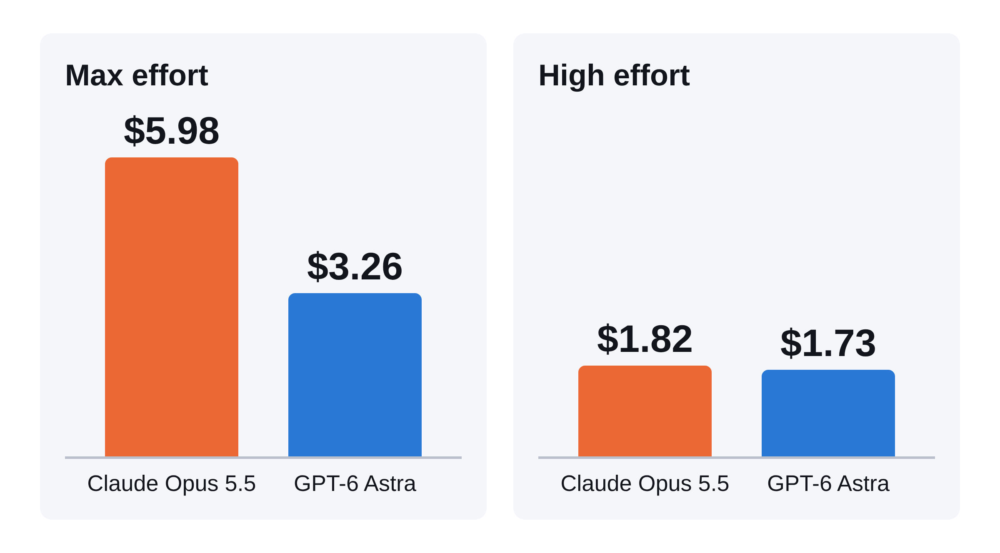
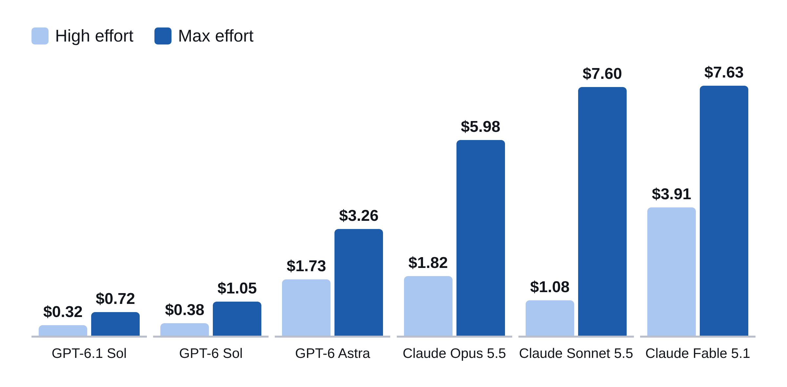
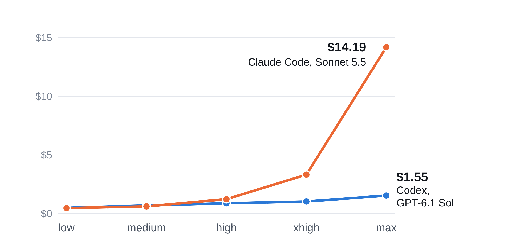

# Artificial Analysis's Cost per Task chart mixes effort settings

The Cost per Task chart on the [Artificial Analysis](https://artificialanalysis.ai/) front page shows most models at max effort and a few at high or xhigh. It doesn't say which.

The same two models, from their own data:



At max, Opus 5.5 costs 1.8× as much as GPT-6 Astra. At high they are 5% apart.

I read the chart at face value and didn't use Claude for two months.

## Every model with both settings



## Claude Code against Codex



From the Coding Agent Index, which runs each vendor's own tool. At high, both take about 38 steps per task. At max, Claude Code takes 266 and Codex takes 40.

Opus 5.5 and GPT-6 Astra are only published there at max.

## Fix

- Label the effort setting on every bar.
- Default every model to the same setting.

## My own numbers

My code-review benchmark runs each vendor's tool on the same 52 code changes at high effort.

| | Mean input tokens per review | Median seconds |
|---|---|---|
| Claude Code, Opus 5.5 | 158k | 27 |
| Claude Code, Sonnet 5.5 | 120k | 17 |
| Codex, GPT-5.6 Sol | 249k | 82 |

Short reviews and an older OpenAI model, so only indicative.

## Data

All other figures are Artificial Analysis's, read from its pages on 30 September 2026. To pull them again:

```bash
python3 extract.py
```

It writes `data/intelligence_index.csv` and `data/coding_agent_index.csv`.

Sources: [model pages](https://artificialanalysis.ai/models/claude-opus-5-5), [Coding Agent Index](https://artificialanalysis.ai/agents/coding-agents), [methodology](https://artificialanalysis.ai/methodology/intelligence-benchmarking).

Charts and script made with Claude Code.
