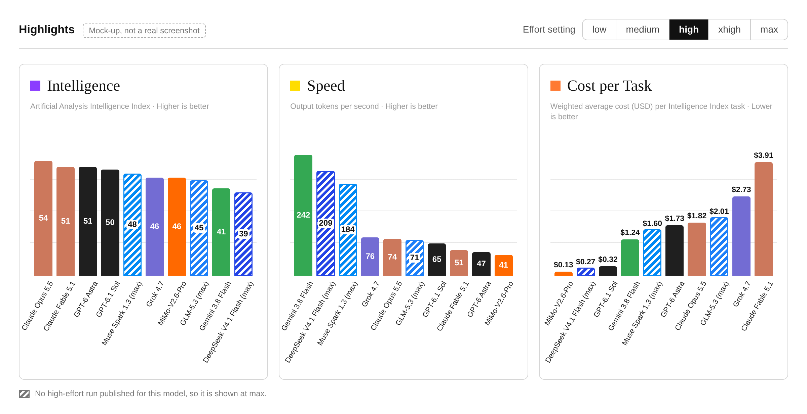

# Artificial Analysis's Cost per Task chart mixes effort settings

Cost per Task is one of the first three charts on the [Artificial Analysis](https://artificialanalysis.ai/) front page. Each bar is one model at one effort setting: most at max, a few at high or xhigh. The setting is there, but only as a suffix in the small rotated label under the bar.

So the chart reads as "what each model costs", when most of what it shows is what each model's most expensive setting costs.

## The same two models at two settings


At max, Claude Opus 5.5 costs 1.8× as much per task as GPT-6 Astra. At high, the two are 5% apart. Nothing changed except the effort setting, and both sets of numbers are Artificial Analysis's own.

I read the front-page chart at face value, concluded Claude was too expensive, and didn't use it for two months. I run my own benchmark across both vendors' tools and still didn't think to check the setting. Most people who see that chart will check even less.

## How much the setting moves each model


These are the six models published at both high and max. Going from high to max roughly doubles the cost for some and multiplies it by seven for one. The score gained varies just as much.

| Model | High | Max | Cost multiple | Index score, high → max |
|---|---|---|---|---|
| GPT-6.1 Sol | $0.32 | $0.72 | 2.3× | 50.2 → 51.8 |
| GPT-6 Sol | $0.38 | $1.05 | 2.8× | 42.8 → 47.5 |
| GPT-6 Astra | $1.73 | $3.26 | 1.9× | 50.9 → 52.7 |
| Claude Opus 5.5 | $1.82 | $5.98 | 3.3× | 53.6 → 57.6 |
| Claude Sonnet 5.5 | $1.08 | $7.60 | 7.0× | 46.7 → 56.0 |
| Claude Fable 5.1 | $3.91 | $7.63 | 2.0× | 51.2 → 53.4 |

Cost is the weighted average cost per Intelligence Index task (v4.3.2). The setting changes a model's position on the chart more than the choice of vendor does.

## The same pattern in the vendors' own tools

The Coding Agent Index runs each vendor's own coding tool. It publishes a full effort ladder for two pairings.


| Setting | Claude Code, Sonnet 5.5 | Codex, GPT-6.1 Sol |
|---|---|---|
| low | $0.48, 19 steps | $0.50, 36 steps |
| medium | $0.62, 22 steps | $0.70, 38 steps |
| high | $1.24, 37 steps | $0.89, 39 steps |
| xhigh | $3.33, 78 steps | $1.04, 40 steps |
| max | $14.19, 266 steps | $1.55, 40 steps |

Through high, the two tools are in the same range on cost and steps. The gap opens at xhigh and max, where Claude keeps working far longer and Codex barely changes.

Claude Opus 5.5 and GPT-6 Astra are only published there at max, which is the setting where the two vendors differ most.

## What I'm asking for

- Default every model to the same effort setting.
- Make the setting a visible control, not a suffix in the bar label.

A mock-up of the Highlights row with a selector set to high. Every figure in it is a published one.



Three of the ten models have no high-effort run, so they are striped and shown at max. The intelligence ranking stays in the same order. The cost chart changes a lot: the most expensive bar drops from $7.63 to $3.91.

## Fair objections

- **Effort names aren't equivalent across vendors.** "High" for one vendor is not the same amount of work as "high" for another. Showing each model at its best-scoring setting is a defensible default. My point is that the default should be obvious to someone who only looks at the bars.
- **The cost chart matches the score chart.** Both use the same configurations, so each cost bar is the true price of the score beside it. At high, Opus 5.5's score drops from 58 to 54 along with its cost.
- **This doesn't show Claude is cheap.** GPT-6.1 Sol is far cheaper at every setting, and Claude Fable 5.1 is the most expensive model at high too. On the two longest evals at high, GPT-6 Astra is 21 to 24% cheaper than Opus 5.5.
- **Cost per task is a blend.** It is a weighted average across ten evals, so it is not the cost of any single task.

## My own numbers

My code-review benchmark runs each vendor's tool on the same 52 code changes at high effort.

| | Mean input tokens per review | Median seconds |
|---|---|---|
| Claude Code, Opus 5.5 | 158k | 27 |
| Claude Code, Sonnet 5.5 | 120k | 17 |
| Codex, GPT-5.6 Sol | 249k | 82 |

These are short reviews and an older OpenAI model, so they are only indicative. At high effort, Claude was not the token-hungry option.

## Data

Every figure outside "My own numbers" is Artificial Analysis's, read on 30 September 2026 from the data embedded in its pages. To pull it again:

```bash
python3 extract.py
```

The script downloads one model page and the Coding Agent Index page, decodes the embedded data, and writes two files:

- `data/intelligence_index.csv`: score, cost per task by token type, cost to run and Terminal-Bench 4.0 results for each effort setting of eight model families.
- `data/coding_agent_index.csv`: score, cost, wall time, steps, tokens and cache hit rate for every Claude Code and Codex entry.

It uses the Python standard library only, and stops with an error if the page layout changes.

Sources: [front page](https://artificialanalysis.ai/), [model pages](https://artificialanalysis.ai/models/claude-opus-5-5), [Coding Agent Index](https://artificialanalysis.ai/agents/coding-agents), [methodology](https://artificialanalysis.ai/methodology/intelligence-benchmarking).

Charts and script made with Claude Code.
